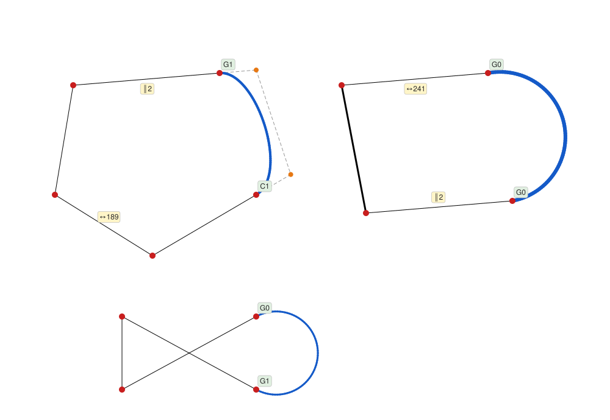
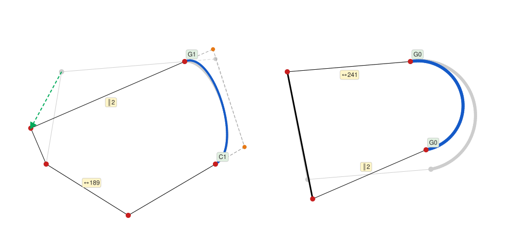
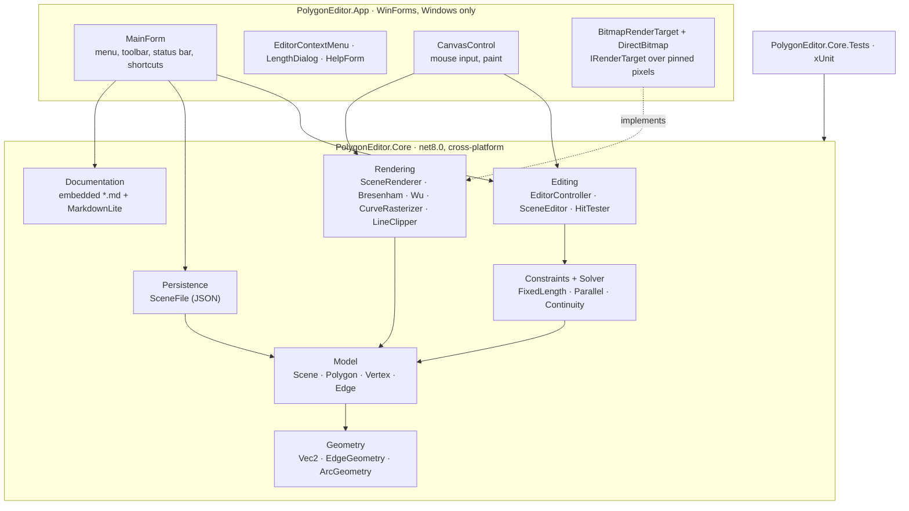
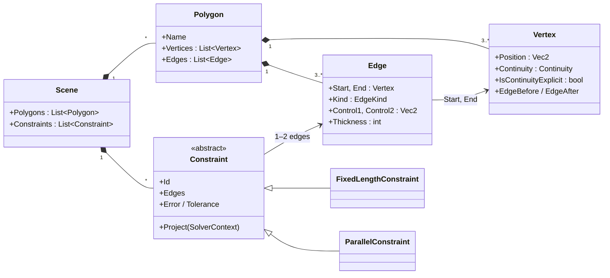
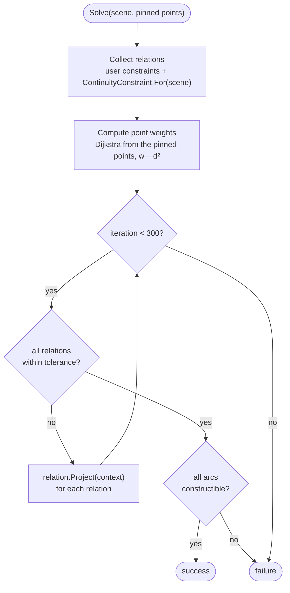
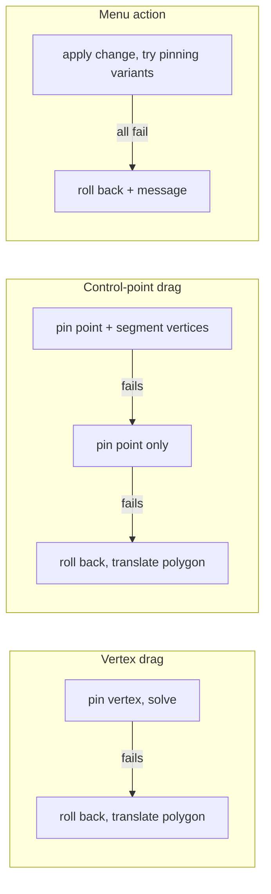
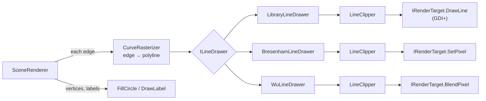
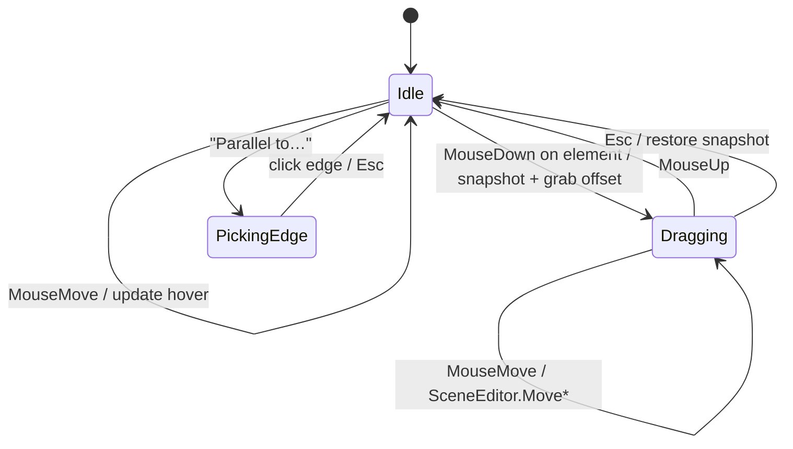
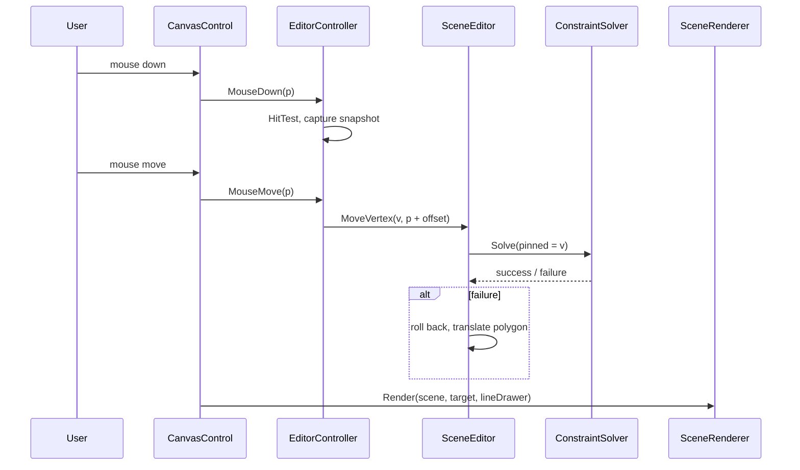

# Polygon Editor

An interactive editor for polygons whose edges can be straight segments, cubic Bézier curves or circular arcs, with **geometric constraints** (fixed length, parallel edges) and **G0 / G1 / C1 continuity** that are kept satisfied live while you drag.

Developed as a project for the **Computer Graphics** course at the **Warsaw University of Technology** (Politechnika Warszawska).

Built in **C# / .NET 8**. The core (model, geometry, constraint solver, rasterization) is a platform-independent library with 98 unit tests; the UI is a thin WinForms shell.

<p align="center">
  
</p>

<p align="center"><sub>The startup scene, rendered by <code>SceneRenderer</code>. Red: vertices · orange: Bézier control points · blue: curves · labels: continuity class (green) and constraints (yellow: <code>↔L</code> fixed length, <code>∥n</code> parallel pair n).</sub></p>

---

## Contents

- [Features](#features)
- [Getting started](#getting-started)
- [Usage](#usage)
- [Architecture](#architecture)
- [Data model](#data-model)
- [Constraint solver](#constraint-solver)
- [Rendering pipeline](#rendering-pipeline)
- [Interaction](#interaction)
- [Algorithms](#algorithms)
- [Testing](#testing)
- [Project structure](#project-structure)
- [Extending](#extending)
- [License](#license)

---

## Features

| | |
|---|---|
| **Edge types** | Line segment, cubic Bézier curve, circular arc. Any edge can be switched at runtime. |
| **Continuity** | Per-vertex G0, G1 or C1 where a curve meets another edge. Default G1 for Bézier joints; arcs support G0/G1. |
| **Constraints** | Fixed length (`↔L`) and parallel edges (`∥n`), including between different polygons. Parallelism is transitive. |
| **Live solving** | A weighted iterative-projection solver keeps every constraint and continuity satisfied while dragging, so the dragged point always stays under the cursor. |
| **Safe fallback** | If constraints cannot be met, the whole polygon is translated (which preserves all of them) or the change is rolled back. |
| **Editing** | Drag vertices, control points, edges or whole polygons; insert / delete vertices (Bézier split by de Casteljau, shape-preserving); `Esc` cancels a drag. |
| **Line algorithms** | Switch between the GDI+ library line, a custom **Bresenham** and a custom antialiased **Xiaolin Wu** rasterizer, with per-edge line thickness. |
| **Persistence** | Save / load scenes as versioned JSON (`Ctrl+S` / `Ctrl+O`). |
| **Built-in help** | `F1` opens embedded documentation (Polish), rendered from Markdown. |

### The solver at work

Dragging the top-left vertex of the pentagon (green arrow). Its top edge is constrained parallel to the bottom edge of the quadrilateral (`∥2`), so the other polygon rotates to follow, while the fixed lengths (`↔189`, `↔241`) and the G1 / C1 joints of the Bézier edge stay intact. The grey outline is the state before the drag.

<p align="center">
  
</p>

### Custom line rasterizers

The same region (a thin segment and a 6&nbsp;px arc), magnified 4×:

| Bresenham (integer midpoint) | Xiaolin Wu (antialiased, coverage-based thickness) |
|:---:|:---:|
|  |  |

---

## Getting started

**Requirements:** [.NET 8 SDK](https://dotnet.microsoft.com/download). The application needs **Windows** (WinForms); the core library and tests run on any OS.

```bash
git clone https://github.com/ulyanafrolova/PolygonEditor.git
cd PolygonEditor

dotnet test                                    # all platforms
dotnet run --project src/PolygonEditor.App     # Windows only
```

Alternatively, open `PolygonEditor.sln` in Visual Studio 2022 and run `PolygonEditor.App`.

> The UI and the built-in documentation are in Polish, as the project was written for a course at the Warsaw University of Technology. Source code and comments are in English.

## Usage

| Input | Action |
|---|---|
| **Left drag** on a vertex | Move the vertex; the rest of the scene adapts |
| **Left drag** on a control point | Reshape the Bézier curve (its vertices stay put when possible) |
| **Left drag** on an edge / inside | Move the whole polygon |
| **Right click** | Context menu: edge type, continuity, length, parallel-to…, thickness, insert / delete vertex, remove constraint |
| `Del` | Delete the hovered vertex (polygons keep ≥ 3 vertices) |
| `Esc` | Cancel the current drag (restores the whole scene) or edge picking |
| `Ctrl+S` / `Ctrl+O` | Save / load scene |
| `F1` | Documentation |

The toolbar selects the line algorithm; the status bar describes the element under the cursor.

---

## Architecture

The solution is split into a UI-agnostic core and a thin presentation layer. The core never references WinForms; it draws through an `IRenderTarget` interface that the app implements.



**Key design rules**

- **Single write path.** All model mutators are `internal`; the only public way to change a scene is `SceneEditor`. Every change runs the solver and is rolled back on failure, so the scene can never be left inconsistent.
- **Constraints live in the scene, not on edges**, because a parallel constraint can link edges of different polygons.
- **Arcs store no parameters.** Center and radius are derived from the endpoints and the continuity of the neighbours (`ArcGeometry`), so an arc is always consistent with its surroundings.
- **Edges are immutable in topology.** Inserting or removing a vertex creates new `Edge` objects, which makes it trivial to drop constraints attached to the old ones.

| Pattern | Where |
|---|---|
| Facade | `SceneEditor` — the single entry point for mutations |
| Strategy | `ILineDrawer` → `LibraryLineDrawer` / `BresenhamLineDrawer` / `WuLineDrawer` |
| Adapter | `BitmapRenderTarget` adapts GDI+ / `DirectBitmap` to `IRenderTarget` |
| State machine | `EditorController` (idle / dragging / picking an edge) |
| Memento | `GeometrySnapshot` — capture & restore all point positions |

---

## Data model



Edge *i* connects vertex *i* to vertex *(i + 1) mod n*. Every edge is a parametric curve `P(t), t ∈ [0, 1]`, so hit-testing, rendering and continuity code treat all edge kinds uniformly.

| Edge kind | Definition |
|---|---|
| **Line** | `P(t) = A + t(B − A)` |
| **Bézier** | `P(t) = (1−t)³V₀ + 3t(1−t)²V₁ + 3t²(1−t)V₂ + t³V₃`, tangents `3(V₁−V₀)` and `3(V₃−V₂)` |
| **Arc** | G0 at both ends → semicircle over the chord. G1 at one end → arc tangent to the neighbouring edge, center at the intersection of the tangent's normal and the chord's perpendicular bisector. |

| Continuity | Condition at a joint (incoming tangent `t_in`, outgoing `t_out`) |
|---|---|
| **G0** | Positions coincide |
| **G1** | `t_in / ‖t_in‖ = t_out / ‖t_out‖` — same direction |
| **C1** | `t_in = t_out` — same direction and magnitude (not available for arcs) |

Length and parallel constraints act on an edge's **chord** (the segment between its vertices), so they mean the same thing for every edge kind.

---

## Constraint solver

`Constraints/Solver/ConstraintSolver.cs` — a weighted **Gauss–Seidel / iterative-projection** solver, in the spirit of position-based dynamics.

Every relation implements `ISolvable` (`Points`, `Error`, `Tolerance`, `Project`). Relations are the user constraints plus `ContinuityConstraint`s generated on the fly for each G1/C1 joint. Each `Project` call moves its own points just enough to satisfy itself; the solver sweeps all relations until everything is within tolerance or 300 iterations pass.



**Weights decide who moves.** Points form a graph (adjacent vertices, vertex ↔ control point, points of the same joint: cost 1; points of the same user constraint: cost 2). Dijkstra from the pinned points gives each point a distance `d`, and its weight is `d²`. Pinned points have weight 0, so corrections propagate outward from the cursor and far-away geometry absorbs most of the change.

```
pinned (cursor)
V0 ──1── V1 ──1── V2 ──1── V3
w=0      w=1      w=4      w=9
```

| Relation | Projection | Tolerance |
|---|---|---|
| Fixed length | Move both endpoints along the chord, split by weight | 0.05 px |
| Parallel | Rotate each edge (length-preserving) toward the direction of the less mobile one; same or opposite orientation is kept | \|sin θ\| ≤ 10⁻⁴ |
| G1 | Rotate the more mobile handle about the vertex onto the other handle's line, keeping its distance | 10⁻⁴ |
| C1 | Linear condition `(k_in+k_out)V − k_in·H_in − k_out·H_out = 0`, solved in one weighted least-change step (`k = 3` Bézier, `1` line) | 0.05 |

**Fallback strategy.** A failed solve never leaves the scene broken:



Translation is always a valid fallback: it preserves every length, direction and tangent.

---

## Rendering pipeline



- Bézier curves are flattened with **forward differencing** (three vector additions per point), arcs by **incremental rotation** of the radius vector (no per-step `sin`/`cos`).
- Every segment is clipped with **Liang–Barsky** before rasterization, so near-flat arcs with huge radii never overflow integer coordinates.
- `DirectBitmap` wraps a pinned `int[]`, making `SetPixel` a plain array write while GDI+ can still draw into the same memory.

---

## Interaction





Hit-testing priority: control point → vertex → edge → polygon interior (even-odd rule, works for self-intersecting polygons). Polygons drawn later take precedence.

---

## Algorithms

| Algorithm | Location | Purpose |
|---|---|---|
| Bresenham (midpoint) line | `Rendering/BresenhamLineDrawer.cs` | Integer-only line rasterization, all octants, dashed lines |
| Xiaolin Wu line & circle | `Rendering/WuLineDrawer.cs` | Antialiased lines and arcs with coverage-based thickness |
| Forward differencing | `Rendering/CurveRasterizer.cs` | Fast Bézier evaluation in power basis |
| Incremental rotation | `Rendering/CurveRasterizer.cs` | Arc points without trigonometry per step |
| Liang–Barsky clipping | `Rendering/LineClipper.cs` | Clip segments to the viewport |
| de Casteljau subdivision | `Model/Polygon.cs` | Split a Bézier edge at t = ½ without changing its shape |
| Tangent arc construction | `Geometry/ArcGeometry.cs` | Arc center from tangent normal ∩ chord bisector |
| Gauss–Seidel projections | `Constraints/Solver/ConstraintSolver.cs` | Iterative constraint solving |
| Weighted least-change projection | `Constraints/Solver/ContinuityConstraint.cs` | One-step C1 enforcement |
| Dijkstra | `ConstraintSolver.ComputeWeights` | Point mobility weights |
| Breadth-first search | `SceneEditor.ParallelClass` | Transitive classes of parallel edges |
| Even-odd ray casting | `Editing/HitTester.cs` | Point-in-polygon test |

---

## Testing

```bash
dotnet test
```

98 xUnit tests cover the core library on any OS:

| Suite | Covers |
|---|---|
| `ModelTests` | Vertex insertion / removal, de Casteljau shape preservation, default vs explicit continuity, arc construction, startup scene validity |
| `SolverTests` | Dragging with fixed lengths, square → rhombus, cross-polygon parallelism, G1/C1 joints, honest failure when everything is pinned |
| `EditingTests` | Hit-test priorities, even-odd on a bow tie, grab offset, `Esc` rollback, arc rules |
| `ArcAndParallelTests` | Rigid rotation of another polygon, degenerate and huge-radius arcs |
| `RasterizationTests` | Bresenham endpoints and connectivity in all octants, forward differences vs Bernstein form, Liang–Barsky, arc points on the circle |
| `SceneFileTests` | JSON round-trip, constraint numbering after load, rejection of invalid files |
| `AuditRegressionTests` | Regressions plus a randomized editing session that must keep the scene consistent |
| `DocumentationTests` | Embedded docs present, ordered and well-formed |

---

## Project structure

```
PolygonEditor/
├── PolygonEditor.sln
├── LICENSE
├── docs/images/                     README illustrations
├── src/
│   ├── PolygonEditor.Core/          platform-independent library (net8.0)
│   │   ├── Geometry/                Vec2, edge & arc geometry, utilities
│   │   ├── Model/                   Scene, Polygon, Vertex, Edge, continuity rules
│   │   ├── Constraints/             FixedLength, Parallel
│   │   │   └── Solver/              ConstraintSolver, ContinuityConstraint, weights
│   │   ├── Editing/                 SceneEditor, EditorController, HitTester, snapshots
│   │   ├── Rendering/               SceneRenderer, Bresenham, Wu, clipping, curves
│   │   ├── Persistence/             SceneFile (JSON)
│   │   ├── Scenes/                  InitialScene (demo scene)
│   │   └── Documentation/           embedded user docs (Polish) + Markdown renderer
│   └── PolygonEditor.App/           WinForms application (net8.0-windows)
│       ├── Canvas/                  CanvasControl, DirectBitmap, BitmapRenderTarget
│       ├── MainForm.cs              window, menu, toolbar, shortcuts
│       └── EditorContextMenu.cs     right-click actions
└── tests/
    └── PolygonEditor.Core.Tests/    xUnit tests
```

---

## Extending

**Add a polygon to the startup scene** — in `Scenes/InitialScene.cs`, before `Settle(scene)`:

```csharp
var w4 = scene.AddPolygon((600, 600), (820, 540), (760, 700));
w4.Edges[0].MakeBezier();                    // control points are placed automatically
scene.AddFixedLength(w4.Edges[1]);           // lock the current length
scene.AddParallel(w4.Edges[2], w1.Edges[3]); // constraint across polygons
```

**Add a constraint type**

1. Derive from `Constraint` in `Constraints/` and implement `Edges`, `IconText`, `Description`, `Error`, `Tolerance` and `Project(SolverContext)`.
2. Add `Scene.AddXxx` and a `SceneEditor` method that wraps it in `TryChange`.
3. Expose it in `EditorContextMenu`.

The solver needs no changes: it works with any `ISolvable`.

---

## Acknowledgements

This project was created as coursework for **Computer Graphics** (Grafika komputerowa) at the **Warsaw University of Technology** (Politechnika Warszawska).

## License

Released under the [MIT License](LICENSE).
